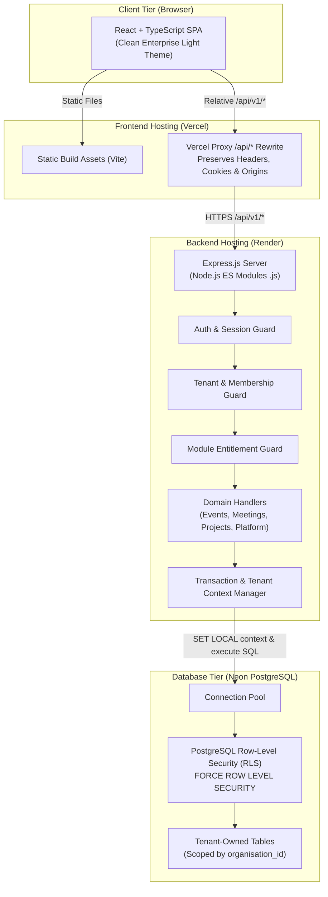
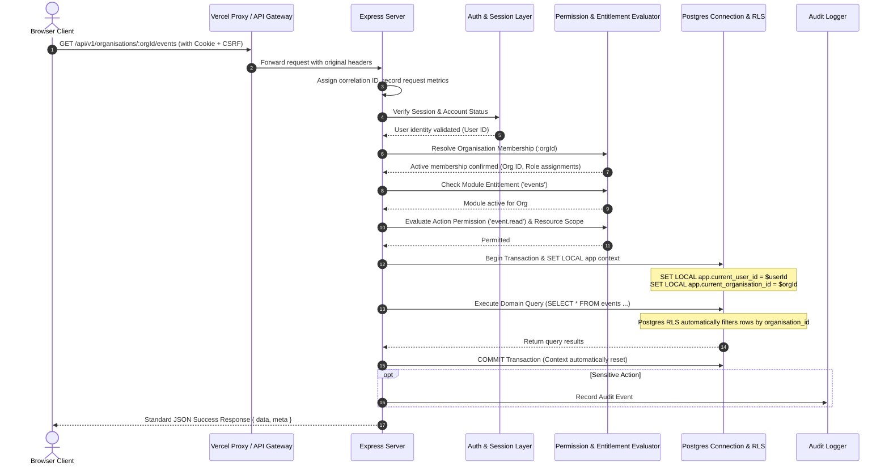

# ManageX Architecture Specification

## 1. System Topology & Deployment Architecture

ManageX is designed as a **modular monolith** with clean physical and logical boundaries between the frontend application, the backend API, and the PostgreSQL database.



---

## 2. Fixed Technology Stack Invariants

| Layer | Technology | Key Constraints & Invariants |
|---|---|---|
| **Frontend** | React 18+, TypeScript, Vite, Tailwind CSS, React Router v6+, TanStack Query | - Strict TypeScript compile settings.<br>- ManageX Clean Enterprise light theme design tokens.<br>- No arbitrary CSS frameworks or external component suites without ADR. |
| **Backend** | Node.js 20+, Express.js, Native ES Modules (`.js`) | - **Native `.js` ES modules only** (`"type": "module"` in `package.json`).<br>- **Strictly NO backend `.ts` files or compilation steps**.<br>- Modular monolith structure; domain logic encapsulated in dedicated folders. |
| **Validation** | Zod | - Runtime validation on all incoming query, param, and body payloads at the API boundary.<br>- Shared schema contracts between frontend and backend. |
| **Database** | PostgreSQL 16+ (Neon compatible), `pg` driver | - Pure SQL migrations tracked by timestamp/version.<br>- PostgreSQL Row-Level Security (`FORCE RLS`).<br>- Multi-tenancy via shared database and shared schema with tenant isolation. |
| **Hosting** | Vercel (Frontend), Render (Backend), Neon (Database) | - Zero paid infrastructure dependencies for MVP.<br>- Same-origin proxy routing via Vercel rewrites to avoid fragile third-party cookie restrictions. |

---

## 3. Modular Monolith Architecture & Boundaries

The codebase is organized into domain modules that share common platform infrastructure:

```text
backend/
├── src/
│   ├── index.js                     # Server entrypoint and graceful shutdown
│   ├── app.js                       # Express setup, middleware chains, error handling
│   ├── config/                      # Validated environment variables (Zod)
│   ├── platform/                    # Shared Platform Core
│   │   ├── auth/                    # Identity, sessions, password hashing, cookies, CSRF
│   │   ├── organisations/           # Organisation lifecycle, memberships, invitations
│   │   ├── rbac/                    # Central permission catalogue, scoped RBAC evaluator
│   │   ├── modules/                 # Module catalogue & organisation entitlements
│   │   ├── audit/                   # Append-only audit logger
│   │   ├── database/                # Connection pool, transaction helper, RLS setter
│   │   ├── email/                   # Email delivery abstraction (development & provider)
│   │   └── middleware/              # Correlation ID, error handler, rate limiter, logger
│   └── modules/                     # Domain Business Modules
│       ├── events/                  # Events & Hackathons domain logic & routes
│       ├── meetings/                # Meetings, agendas, confidential minutes & action items
│       ├── projects/                # Projects, tasks, memberships & Kanban workflows
│       └── admin/                   # Platform Super Admin & Support Agent operations
```

### Shared Platform vs. Module Ownership Matrix
1. **Shared Platform Owns:** Identity, session verification, active organisation resolution, transactional RLS context binding, central permission catalogue, module entitlement verification, append-only audit persistence, common `/api/v1` response envelopes, and design system tokens.
2. **Domain Modules Own:** Domain entities, domain-specific validation rules, resource-level policies (e.g. is user assigned to this specific submission or meeting note?), domain endpoints, and module UI views. Modules **never** create their own authentication schemes, session stores, or independent tenant checkers.

---

## 4. End-to-End Request Lifecycle

Every protected API request to an organisation-scoped resource executes the following 9-step evaluation pipeline:



---

## 5. Tenant Context & Database Pooling Architecture

Because database connections are pooled across concurrent requests from different tenants, **session-level context (`SET ...`) is strictly forbidden** as it can leak between requests.

### The Transaction Helper Pattern
All tenant-scoped queries must run through the `withTenantTransaction` helper:

```javascript
// backend/src/platform/database/transaction.js
export async function withTenantTransaction({ userId, organisationId, isPlatformAdmin = false }, callback) {
  const client = await pool.connect();
  try {
    await client.query('BEGIN');
    
    // Set transaction-local session settings (is_local = true)
    await client.query("SELECT set_config('app.current_user_id', $1, true)", [userId || '']);
    await client.query("SELECT set_config('app.current_organisation_id', $2, true)", [organisationId || '']);
    await client.query("SELECT set_config('app.current_is_platform_admin', $3, true)", [isPlatformAdmin ? 'true' : 'false']);
    
    // Execute domain callback with the pinned client
    const result = await callback(client);
    
    await client.query('COMMIT');
    return result;
  } catch (error) {
    await client.query('ROLLBACK');
    throw error;
  } finally {
    // Release client back to the pool
    client.release();
  }
}
```

---

## 6. Frontend Architecture & Cache Segregation

The frontend application uses **React Router v6+** and **TanStack Query**.

### Cache Isolation Key Rule
To prevent data flashing or cross-tenant leakage in browser memory when switching organisations:
1. Every query key for organisation-scoped data must be prefixed with the active `organisationId`:
   ```typescript
   ['organisations', organisationId, 'events', { status: 'published' }]
   ```
2. When the user switches organisations via the UI switcher:
   - TanStack Query cache for the prior organisation is invalidated and removed.
   - Active workspace state is updated.
   - Fresh context is fetched from `/api/v1/organisations/:newOrgId`.
3. On logout:
   - Full query cache is purged (`queryClient.clear()`).
   - Browser memory is wiped of tenant state.

---

## 7. Error Handling & Standard Responses

All responses adhere to the standard JSON envelopes defined in `docs/api-contracts.md`:
- **Success:** `{ success: true, data: ..., meta: ... }`
- **Error:** `{ success: false, error: { code: string, message: string, details?: any, requestId: string } }`

Production responses **never** expose stack traces, raw SQL queries, or internal database table names.
