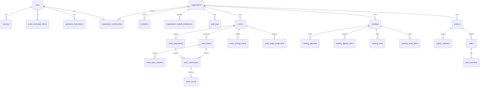

# ManageX Database Architecture & Data Dictionary

## 1. Logical Entity-Relationship (ER) Overview

ManageX uses a single shared PostgreSQL database and schema with strict tenant isolation enforced by Row-Level Security (RLS) and composite foreign keys.



---

## 2. Core Entities by Phase and Migration Plan

Database migrations arrive incrementally according to the approved implementation phases:

### Phase 2: Core Platform, Identity, Organisation & RLS Foundation
- `schema_migrations` — Internal table tracking applied SQL migration files.
- `users` — Global user identity records (email, name, password hash, status, email verification timestamp).
- `sessions` — Server-side active sessions (user_id, token_hash, idle_expires_at, absolute_expires_at, revoked_at).
- `email_verification_tokens` — Single-use expiring tokens for account verification.
- `password_reset_tokens` — Single-use expiring tokens for password recovery.
- `organisations` — Customer workspaces (name, slug, status, created_at, updated_at).
- `organisation_memberships` — Join table between users and organisations (status: `invited`, `active`, `suspended`, `removed`).
- `invitations` — Single-use organisation invitations (token_hash, email, role, expires_at).
- `permissions` — Central permission catalogue (keys: `event.*`, `meeting.*`, `project.*`, `org.*`, `platform.*`).
- `roles` — Scoped roles (scope: `platform`, `organisation`, `module`).
- `role_permissions` — Mapping of permissions to roles.
- `membership_roles` — Scoped role assignments for organisation members.
- `modules` — Catalogue of modules (`events`, `meetings`, `projects`).
- `organisation_module_entitlements` — Active/inactive module state per organisation.
- `audit_logs` — Immutable, append-only log of sensitive actions.

### Phase 6A–6D: Events & Hackathons Module
- `events` — Event details, type (`general_event`, `hackathon`), status (`draft`, `published`, `registration_closed`, `in_progress`, `completed`, `cancelled`, `archived`), timestamps, registration windows, capacity.
- `event_registrations` — Registrations for both org members and external participants (status: `registered`, `withdrawn`).
- `event_teams` — Hackathon teams (team owner, name, min/max size).
- `event_team_members` — Team members with invitation status.
- `event_submissions` — URL-based submissions (title, description, repo_url, demo_url).
- `event_scoring_criteria` — Scoring criteria (name, description, max_score 1..100).
- `event_judge_assignments` — Assigned judges per event/submission.
- `event_scores` — Judge criterion evaluations (score, optional feedback).

### Phase 7A–7B: Meetings Module
- `meetings` — Meeting details, status (`scheduled`, `in_progress`, `completed`, `cancelled`), timestamps, timezone, visibility (`organisation`, `attendees_only`).
- `meeting_attendees` — Internal member attendees and external email invitations.
- `meeting_agenda_items` — Sequenced agenda items (sequence, title, description, time_allocation_mins).
- `meeting_notes` — Confidential meeting notes and minutes (author, note content, access scope).
- `meeting_action_items` — Action items (title, assignee, due_date, priority, status: `open`, `in_progress`, `done`, `cancelled`).

### Phase 8A–8C: Projects & Tasks Module
- `projects` — Project details, status (`planning`, `active`, `on_hold`, `completed`, `archived`), priority (`low`, `medium`, `high`, `urgent`), owner.
- `project_members` — Explicit project membership and roles.
- `tasks` — Task details, status (`backlog`, `todo`, `in_progress`, `blocked`, `done`), priority, assignee, due_date, soft-delete timestamp (`deleted_at`).
- `task_comments` — Comments on tasks (author, body, soft-delete timestamp `deleted_at`).
- `project_activity` — Activity stream for project/task status changes.

---

## 3. Tenant Boundary & Integrity Constraints

### Primary Tenant Scope: `organisation_id`
Every tenant-owned table contains an `organisation_id UUID NOT NULL` column with a foreign key referencing `organisations(id) ON DELETE RESTRICT`.

### Tenant-Aware Composite Foreign Keys
To guarantee database-level isolation and prevent cross-tenant referencing:
```sql
-- Composite unique keys on parent tables
ALTER TABLE projects ADD CONSTRAINT uq_projects_id_org UNIQUE (organisation_id, id);
ALTER TABLE events ADD CONSTRAINT uq_events_id_org UNIQUE (organisation_id, id);
ALTER TABLE meetings ADD CONSTRAINT uq_meetings_id_org UNIQUE (organisation_id, id);

-- Composite foreign keys on child tables
ALTER TABLE tasks ADD CONSTRAINT fk_tasks_project_tenant
  FOREIGN KEY (organisation_id, project_id)
  REFERENCES projects(organisation_id, id) ON DELETE RESTRICT;

ALTER TABLE event_registrations ADD CONSTRAINT fk_registrations_event_tenant
  FOREIGN KEY (organisation_id, event_id)
  REFERENCES events(organisation_id, id) ON DELETE RESTRICT;

ALTER TABLE meeting_attendees ADD CONSTRAINT fk_attendees_meeting_tenant
  FOREIGN KEY (organisation_id, meeting_id)
  REFERENCES meetings(organisation_id, id) ON DELETE RESTRICT;
```

---

## 4. Query-Driven Indexing Strategy

Indexes are added only to satisfy explicit query and filtering patterns:

1. **Tenant Filtering:** `(organisation_id)` on every tenant-owned table.
2. **Lists & Filters:**
   - Events: `(organisation_id, status, start_time)`
   - Meetings: `(organisation_id, status, start_time)`
   - Tasks: `(organisation_id, project_id, status, priority)`
   - Assigned to me: `(organisation_id, assignee_id, status, due_date)`
   - Overdue tasks: `(organisation_id, status, due_date)` WHERE `deleted_at IS NULL`
3. **Natural Keys & Uniqueness:**
   - Users: `LOWER(email)` UNIQUE
   - Organisations: `slug` UNIQUE
   - Memberships: `(organisation_id, user_id)` UNIQUE
   - Event Registrations: `(event_id, user_id)` UNIQUE
   - Meeting Attendees: `(meeting_id, user_id)` UNIQUE

---

## 5. Migration Execution & Safety Rules

1. **Pure SQL Files:** All migrations are plain SQL files named with sequential timestamp prefixes:
   `database/migrations/YYYYMMDDHHMMSS_name.sql`
2. **Zero Destructive Actions:** Migrations never use `DROP TABLE`, `DROP COLUMN`, or `TRUNCATE` in production.
3. **Transactional DDL:** Every migration runs inside a transaction block (`BEGIN ... COMMIT`).
4. **Controlled Execution:** Applied explicitly via `node database/migrate.js` with database target verification.
