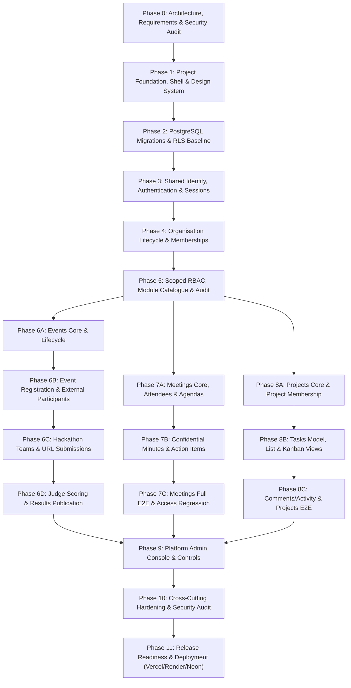

# ManageX Implementation Plan (Phases 0–11)

This plan defines the dependency-ordered implementation phases, vertical slices, prerequisites, and exit criteria required to build ManageX in strict alignment with `docs/PRD.md` and `docs/ManageX_Antigravity_Prompt_Pack.md`.

### Evaluation Hardening Phase 1

The first hardening slice for `docs/event_hack_new_prd.md` is implemented as a forward-only backend change:

1. dedicated evaluation permissions and strict tenant-scoped route authorization;
2. explicit grants for privileged existing roles plus read-only grants for existing judge/participant roles;
3. runtime fixes for evaluation caller detection;
4. `no_show` database constraint alignment and regression coverage.

The migration must be reviewed and applied only through the normal migration process against a confirmed isolated environment. Scheduling concurrency redesign, invitation lifecycle, session-to-submission schema changes, completion workflows, and frontend work remain subsequent phases.

---

## 1. Phase Dependency Roadmap

---

## 2. Phase-by-Phase Breakdown & Exit Criteria

### Phase 0: Requirements, Repository & Security Design Audit (Current)
- **Objective:** Establish the complete architectural and security blueprint before writing application code.
- **Prerequisites:** PRD, AGENTS.md, Prompt Pack.
- **Deliverables:** Planning artefacts (`implementation-plan.md`, `architecture.md`, `database.md`, `security.md`, `api-contracts.md`, `requirements-traceability.md`, `testing.md`, `deployment.md`, `runbook.md`, `future-suggestions.md`, ADRs).
- **Exit Gate:** No code written; all 99 PRD requirements mapped; RLS context & database role separation approved.

### Phase 1: Project Foundation, Shell & Design System
- **Objective:** Establish repo layout (`frontend/`, `backend/`, `database/`, `tests/`), toolchains, Clean Enterprise light theme design tokens, reusable components, and API client shell.
- **Prerequisites:** Approved Phase 0 report.
- **Exit Gate:** Frontend builds (`tsc && vite build`); backend starts and passes lint without `.ts` compile; design system tokens and shell layout responsive.

### Phase 2: PostgreSQL Foundation, Migrations & RLS Baseline
- **Objective:** Pure SQL migration runner, core relational tables, separate `managex_migration` and `managex_app` database roles, and transaction-local RLS helper (`SET LOCAL`).
- **Prerequisites:** Phase 1 complete.
- **Exit Gate:** Local/test DB migrates deterministically; least-privilege DB tests confirm cross-tenant reads/writes fail closed and connection reuse does not leak context.

### Phase 3: Shared Identity, Authentication & Sessions
- **Objective:** Account registration, email verification (single-use tokens), secure login/logout, password reset, session rotation, rate limiting, and CSRF protection.
- **Prerequisites:** Phase 2 complete.
- **Exit Gate:** Complete auth lifecycle tests pass; protected routes return 401 unauthenticated; session invalidation on logout/reset verified; no plaintext credentials stored.

### Phase 4: Organisation Lifecycle, Memberships & Invitations
- **Objective:** Atomic organisation + owner creation, multi-org membership, workspace switching with client cache purge, email invitations (7-day expiry), and final-owner protection.
- **Prerequisites:** Phase 3 complete.
- **Exit Gate:** User in multiple orgs switches safely; invitation concurrency tests pass; last active owner cannot be removed/suspended; ownership transfer requires step-up reauth.

### Phase 5: Central Permission Catalogue, Scoped RBAC & Entitlements
- **Objective:** Central permission catalogue, independent platform/org/module scopes, shared authorization evaluator middleware, module catalogue (`events`, `meetings`, `projects`), and append-only audit logger.
- **Prerequisites:** Phase 4 complete.
- **Exit Gate:** Deactivated module returns 403; unauthorized permission delegation blocked; audit log captures all admin changes without sensitive data.

### Phase 6A–6D: Events & Hackathons Module
- **6A (Core & Lifecycle):** Event model, UTC dates, IANA timezones, draft/published visibility, 7 canonical statuses (`draft`, `published`, `registration_closed`, `in_progress`, `completed`, `cancelled`, `archived`).
- **6B (Registration & Participants):** Public event registration, capacity locking under concurrency, withdrawn/reactivated handling, external participant boundary (no org membership).
- **6C (Hackathon Teams & Submissions):** Team creation (min 1, max 100), single-use invitations, URL-only submissions (http/https validation, no file uploads).
- **6D (Judging & Results):** Assigned-only judge evaluation, 1..100 scoring criteria, private unpublished scores, straight-sum result calculation and explicit publishing.
- **Exit Gate:** Full events test suite passes; external participants isolated from org data; concurrent registration cannot overbook.

### Phase 7A–7C: Meetings Module
- **7A (Core & Agendas):** Meeting scheduling, timezones, internal/external attendees, 4 canonical statuses (`scheduled`, `in_progress`, `completed`, `cancelled`), ordered agenda items.
- **7B (Notes & Action Items):** Confidential minutes restricted to organiser/privileged roles (attendees cannot view by default), action items (assigned to eligible org members).
- **7C (E2E & Integration):** Full journey verification, calendar/list view, access regression tests across tenants.
- **7C-FE (Frontend Remediation & API Contract Alignment):** Aligned status transitions (`POST /:meetingId/status`) and RSVP (`POST /:meetingId/rsvp`), resolved agenda deserialization (`agendaItems`) and reorder preservation, implemented `EditMeetingDialog` with input validation, added frontend test coverage (17 tests across `MeetingsPage.test.tsx` and `MeetingDetailPage.test.tsx`).
- **7-SEC (Meetings Attendees & Agenda RLS Security Remediation):** Migration `20261017000036_meetings_attendees_agenda_rls_sec009.sql` removing legacy `app.current_is_platform_admin` bypass from all 8 policies on `meeting_attendees` and `meeting_agenda_items`; verified with 8/8 dedicated RLS tests in `meetings_rls_sec009.integration.test.js` and 49/49 regression tests.
- **7-MOM (Structured Minutes of Meeting Enhancement):** Migration `20261017000037_meeting_mom_structured.sql` creating `meeting_discussion_points` and `meeting_decisions` with deterministic `order_index`, composite FK integrity, and strict PostgreSQL RLS policies; multi-point discussion & decision CRUD and atomic reordering APIs; `GET /notes` aggregate response preserving historical notes in `meeting_notes`; comprehensive 4-section MOM UI in `MeetingDetailPage.tsx` with Edit Mode vs View Only distinction and cancelled meeting terminal locks; verified with 7/7 tests in `meetings_mom.integration.test.js`, 57/57 backend regression tests, and 4 new tests in `MeetingDetailPage.test.tsx`.
- **Roadmap Phase 1 (Meeting Lifecycle & Polish):** Forward-only migration `20261017000038_meetings_missed_status.sql` adding `missed` status constraint; canonical state machine transitions; `Overdue` badge rendering for scheduled past meetings; timezone normalization (`Asia/Calcutta` -> `Asia/Kolkata`); transient toast notifications.
- **Roadmap Phase 2 (MOM Action Items v2 & Decision Linking):** Forward-only migration `20261017000039_meeting_action_items_decision_project_task.sql` adding composite FKs linking decisions (`decision_id`) and project tasks (`project_task_id`) with `ON DELETE SET NULL`; cross-meeting action items API (`GET /action-items`) with timeframe/priority/status filters; same-meeting and same-tenant decision linking; project task promotion (`POST /:meetingId/action-items/:actionItemId/promote-to-task`) with status mapping and idempotency; `MeetingDetailPage` "+ Action Item" shortcut from decisions, prefilling and locking decision links, and Promote to Task dialog; `MeetingsPage` top-level `[Meetings] | [My Action Items]` sub-tabs navigation and dedicated My Action Items dashboard.
- **Roadmap Phase 3 (Security, Audit & Concurrent Editing):** Forward-only migration `20261017000040_meetings_root_rls_sec009.sql` removing legacy `app.current_is_platform_admin = 'true'` bypass from the root `meetings` table and strictly enforcing tenant isolation; optimistic locking with `expectedUpdatedAt` precondition and concurrency-safe row lock (`SELECT ... FOR UPDATE`), rejecting stale notes writes with HTTP 409 `CONCURRENT_MODIFICATION` without data loss; security audit event `meeting.notes_access_denied` logged on unauthorized read/manage attempts with zero body leakage; action item manager-field locks, terminal state immutability, and quick-status safeguards; verified with 62/62 backend meetings tests, 148/148 frontend tests, and production build.
- **Roadmap Phase 4 (Analytics, Export & Polish):** Markdown and standard binary PDF 1.4 MOM export engines (`markdownGenerator.js`, `pdfGenerator.js`, `GET /:meetingId/export`) with strict confidential notes permission filtering (redacted with notice for non-authorised users), layout-injection entity escaping, and `meeting.exported` audit logging; real-time Meeting Analytics service and endpoint (`GET /analytics?timeframe=all|30d|90d`) calculating real SQL aggregates for meeting status distribution, completion rate, attendance RSVP breakdown, action item progression, and structured MOM outcomes with zero-denominator safety (returns 0 instead of NaN/Infinity); frontend Export controls in `MeetingDetailPage.tsx` for all meeting outcomes; dedicated Analytics sub-tab in `MeetingsPage.tsx` (`[Meetings] | [My Action Items] | [Analytics]`) with executive KPI cards, status breakdowns, and empty state; verified with 82/82 backend meetings tests, 152/152 frontend tests, clean typecheck, and clean production build.
- **Exit Gate:** Confidential minutes remain hidden from ordinary attendees; action items stay within meeting scope; disabled module fails closed; frontend consumes exact backend contracts; database RLS enforces strict tenant isolation without platform-admin bypass; structured MOM supports independent discussion points, decisions, integrated action items, decision-to-action item linking, task promotion, and cross-meeting action item tracking.

### Phase 8A–8C: Projects & Tasks Module
- **8A (Projects Core):** Project model, owner, eligible members, 5 canonical statuses (`planning`, `active`, `on_hold`, `completed`, `archived`), priorities (`low`, `medium`, `high`, `urgent`).
- **8B (Tasks & Kanban):** Task model, 5 canonical statuses (`backlog`, `todo`, `in_progress`, `blocked`, `done`), assignment restricted to project members, List & Kanban views, Assigned to me / Due soon / Overdue.
- **8C (Comments & Acceptance):** Simple text comments (soft deletion), activity timeline, full Projects & Tasks E2E test suite.
- **Exit Gate:** Removing assigned member blocked until tasks reassigned; Kanban mutations validate and reconcile on server; cross-tenant task access blocked.

### Phase 9: Platform Administration Console & Operational Controls
- **Objective:** Separate `/platform` console for Super Admin and Support Agent. Platform catalogue controls, organisation status management, operational metadata inspection.
- **Prerequisites:** Phases 6, 7, 8 complete.
- **Exit Gate:** Support agents cannot view private tenant content; no ticketing product introduced; platform actions fully audited.

### Phase 10: Security, UX, Accessibility & Reliability Hardening
- **Objective:** Cross-cutting security sweep, full RLS penetration tests, WCAG 2.2 AA accessibility verification, input fuzzing, and performance check (under 2s for 1,000-row list queries).
- **Prerequisites:** Phase 9 complete.
- **Exit Gate:** Zero unresolved critical/high vulnerabilities; security review report signed off.

### Post-Phase-10 Refinements & Phase 01: Public Events & External Registration
- **Objective:** Resolve workspace active-state navigation defect, deliver safe single event details (`/events/:eventId`), and external student participant self-registration.
- **Prerequisites:** Phase 10 complete.
- **Exit Gate:** Public event listing and single event query omit internal data; external registrations succeed without creating org membership; workspace navigation highlighting fixed; 100% test pass rate across backend and frontend suites.

### Phase 01C: Organisation-First Product Alignment
- **Objective:** Decouple global event directory, redirect `/events` to `/`, preserve direct shareable hackathon links (`/events/:eventId`), and equip organisers with a workspace share-link copy action.
- **Prerequisites:** Phase 01 complete.
- **Exit Gate:** Global directory removed; direct event links preserved; organiser shareable link button active on published public events; 100% frontend test pass rate (44/44); clean typecheck and build.

### Phase 02B: Multi-Round Hackathon Core Engine
- **Objective:** Establish the multi-round hackathon database foundation, backward-compatible initialization, round management API, and organiser workspace round configuration UI.
- **Prerequisites:** Phase 02A Read-Only Audit approved.
- **Exit Gate:** Migration `025_multi_round_hackathons.sql` applied cleanly with default Round 1 backfill; `event_rounds` and `event_round_advancements` enforced under RLS; round management CRUD routes tested with 100% pass rate (81/81 backend event tests, 46/46 frontend tests); clean frontend typecheck and production build.

### Phase 02C: Multi-Round Submissions, Advancement & Scoring
- **Objective:** Implement round-scoped submissions, round eligibility gating, multi-round advancement engine (`top_n` with cutoff tie qualification, `score_threshold`, `manual`), round-scoped scoring criteria and evaluation, round leaderboard calculation, unpublished score privacy, and round results publication.
- **Prerequisites:** Phase 02B complete.
- **Exit Gate:** Migration `20261017000026_round_scoped_submissions_evaluations.sql` applied cleanly; partial unique indexes and composite FKs prevent cross-event/cross-round leaks; 15/15 tests passing in `advancement.integration.test.js`; 96/96 tests passing across all backend event suites; 47/47 passing frontend tests; clean typecheck and Vite build.

### Phase 02D: Multi-Round Hackathon Finalization & Integrity Hardening
- **Objective:** Complete integrity hardening across advancement consistency, round-scoped judging, score edit lockout after advancement, incomplete judging prevention, immediate unpublication privacy, and safe round deletion guards.
- **Prerequisites:** Phase 02C complete.
- **Exit Gate:** Migration `20261017000027_multi_round_hardening_integrity.sql` applied cleanly; `is_manual` preservation verified; 12/12 tests passing in `hardening.integration.test.js`; 108/108 tests passing across all 7 backend event integration test suites; 47/47 passing frontend tests; clean frontend typecheck.

### Phase 2A: Judge Scheduling & Evaluation Database Foundation
- **Objective:** Implement the forward database schema foundation for optional round-level evaluation and scheduling (`round_evaluations`, `evaluation_panels`, `evaluation_panel_judges`, `evaluation_sessions`), composite uniqueness constraints, cross-event foreign key integrity, non-recursive RLS policies, and database-level integration tests.
- **Prerequisites:** Approved Phase 1B / Phase 1B.1 Architecture Audit.
- **Exit Gate:** Migration `20261017000029_evaluation_database_foundation.sql` applied cleanly; `FORCE ROW LEVEL SECURITY` on all 4 tables; 10/10 tests passing in `evaluation_foundation.integration.test.js`; 100% backward compatibility for rounds without evaluation; zero regressions across existing event test suites.

### Phase 4D: Participant Evaluation Schedule
- **Objective:** Integrate live evaluation appointments and panel schedule details into the participant experience across the Student Dashboard and Public Event pages, while upholding the 10-minute meeting URL unlock policy, redacting internal evaluator data, and enabling manual schedule refresh.
- **Prerequisites:** Phase 4C / 4C-BE complete.
- **Exit Gate:** Reusable `ParticipantEvaluationSchedule` component implemented with loading, error, empty, active, and lock-timer states; integrated into `StudentDashboardPage.tsx` and `PublicEventDetailPage.tsx`; 8/8 component tests passing; 97/97 total frontend tests passing; zero typecheck errors and clean Vite production bundle.

### Phase 4E: End-to-End Evaluation Workflow Verification
- **Objective:** Exhaustively verify the end-to-end evaluation lifecycle across Organiser, Judge, Participant, and Public personas: event setup, round/criteria configuration, judge token invitation & assignment, scheduling concurrency, schedule publication, external judge session scoring, participant meeting unlock, completion idempotency, results publication/unpublication, and multi-round advancement. Remediate uncovered routing gaps and enforce non-destructive test isolation.
- **Prerequisites:** Phase 4D complete.
- **Exit Gate:** Full lifecycle validated across 8 backend test suites (135+ tests passing on `managex_test`), 97/97 frontend tests passing, clean TypeScript compilation, clean Vite production build, zero destructive cleanup in test suites, verified route mounts in `events.js`, and documented remaining gaps.

### Phase 4F: Judge Workspace Scoring UI
- **Objective:** Implement interactive judge scoring workflow within `JudgeWorkspacePage` using existing session-scoped backend APIs (`GET/POST .../evaluation/sessions/:sessionId/work|scores`), supporting criteria display, rubric validation, score entry, private notes, duplicate prevention, state preservation on failure, and real-time total calculations.
- **Prerequisites:** Phase 4E complete.
- **Exit Gate:** `JudgeScoringDialog` implemented and integrated into `JudgeWorkspacePage.tsx`; 11/11 focused tests passing in `JudgeWorkspacePage.test.tsx`; 105/105 total frontend tests passing; 0 TypeScript compilation errors; clean production bundle build (`npm run build`).

### Phase 11: Staging/Production Release Readiness & Free-Tier Deployment
- **Objective:** Preflight environment configuration, Vercel frontend build/rewrite verification, Render backend deployment, Neon PostgreSQL migrations, runbook validation.
- **Prerequisites:** Phase 10 complete.
- **Exit Gate:** Deployment verified or dry-run documented with truthful statuses; free-tier limits clearly stated in runbook.
