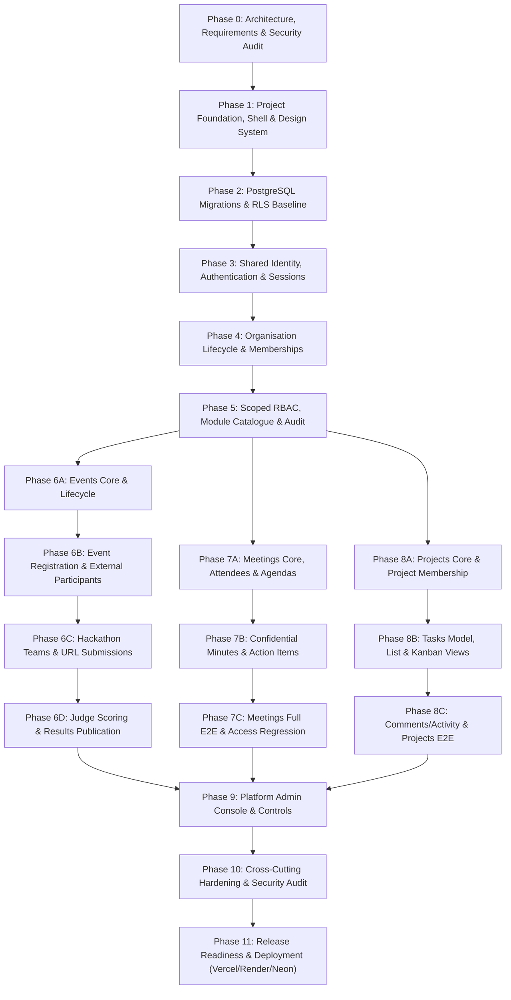

# ManageX Implementation Plan (Phases 0–11)

This plan defines the dependency-ordered implementation phases, vertical slices, prerequisites, and exit criteria required to build ManageX in strict alignment with `docs/PRD.md` and `docs/ManageX_Antigravity_Prompt_Pack.md`.

---

## 1. Phase Dependency Roadmap

---

## 2. Phase-by-Phase Breakdown & Exit Criteria

### Phase 0: Requirements, Repository & Security Design Audit (Current)
- **Objective:** Establish the complete architectural and security blueprint before writing application code.
- **Prerequisites:** PRD, AGENTS.md, Prompt Pack.
- **Deliverables:** Planning artefacts (`implementation-plan.md`, `architecture.md`, `database.md`, `security.md`, `api-contracts.md`, `requirements-traceability.md`, `testing.md`, `deployment.md`, `runbook.md`, `future-suggestions.md`, ADRs).
- **Exit Gate:** No code written; all 99 PRD requirements mapped; RLS context & database role separation approved.

### Phase 1: Project Foundation, Shell & Design System
- **Objective:** Establish repo layout (`frontend/`, `backend/`, `database/`, `tests/`), toolchains, Clean Enterprise light theme design tokens, reusable components, and API client shell.
- **Prerequisites:** Approved Phase 0 report.
- **Exit Gate:** Frontend builds (`tsc && vite build`); backend starts and passes lint without `.ts` compile; design system tokens and shell layout responsive.

### Phase 2: PostgreSQL Foundation, Migrations & RLS Baseline
- **Objective:** Pure SQL migration runner, core relational tables, separate `managex_migration` and `managex_app` database roles, and transaction-local RLS helper (`SET LOCAL`).
- **Prerequisites:** Phase 1 complete.
- **Exit Gate:** Local/test DB migrates deterministically; least-privilege DB tests confirm cross-tenant reads/writes fail closed and connection reuse does not leak context.

### Phase 3: Shared Identity, Authentication & Sessions
- **Objective:** Account registration, email verification (single-use tokens), secure login/logout, password reset, session rotation, rate limiting, and CSRF protection.
- **Prerequisites:** Phase 2 complete.
- **Exit Gate:** Complete auth lifecycle tests pass; protected routes return 401 unauthenticated; session invalidation on logout/reset verified; no plaintext credentials stored.

### Phase 4: Organisation Lifecycle, Memberships & Invitations
- **Objective:** Atomic organisation + owner creation, multi-org membership, workspace switching with client cache purge, email invitations (7-day expiry), and final-owner protection.
- **Prerequisites:** Phase 3 complete.
- **Exit Gate:** User in multiple orgs switches safely; invitation concurrency tests pass; last active owner cannot be removed/suspended; ownership transfer requires step-up reauth.

### Phase 5: Central Permission Catalogue, Scoped RBAC & Entitlements
- **Objective:** Central permission catalogue, independent platform/org/module scopes, shared authorization evaluator middleware, module catalogue (`events`, `meetings`, `projects`), and append-only audit logger.
- **Prerequisites:** Phase 4 complete.
- **Exit Gate:** Deactivated module returns 403; unauthorized permission delegation blocked; audit log captures all admin changes without sensitive data.

### Phase 6A–6D: Events & Hackathons Module
- **6A (Core & Lifecycle):** Event model, UTC dates, IANA timezones, draft/published visibility, 7 canonical statuses (`draft`, `published`, `registration_closed`, `in_progress`, `completed`, `cancelled`, `archived`).
- **6B (Registration & Participants):** Public event registration, capacity locking under concurrency, withdrawn/reactivated handling, external participant boundary (no org membership).
- **6C (Hackathon Teams & Submissions):** Team creation (min 1, max 100), single-use invitations, URL-only submissions (http/https validation, no file uploads).
- **6D (Judging & Results):** Assigned-only judge evaluation, 1..100 scoring criteria, private unpublished scores, straight-sum result calculation and explicit publishing.
- **Exit Gate:** Full events test suite passes; external participants isolated from org data; concurrent registration cannot overbook.

### Phase 7A–7C: Meetings Module
- **7A (Core & Agendas):** Meeting scheduling, timezones, internal/external attendees, 4 canonical statuses (`scheduled`, `in_progress`, `completed`, `cancelled`), ordered agenda items.
- **7B (Notes & Action Items):** Confidential minutes restricted to organiser/privileged roles (attendees cannot view by default), action items (assigned to eligible org members).
- **7C (E2E & Integration):** Full journey verification, calendar/list view, access regression tests across tenants.
- **Exit Gate:** Confidential minutes remain hidden from ordinary attendees; action items stay within meeting scope; disabled module fails closed.

### Phase 8A–8C: Projects & Tasks Module
- **8A (Projects Core):** Project model, owner, eligible members, 5 canonical statuses (`planning`, `active`, `on_hold`, `completed`, `archived`), priorities (`low`, `medium`, `high`, `urgent`).
- **8B (Tasks & Kanban):** Task model, 5 canonical statuses (`backlog`, `todo`, `in_progress`, `blocked`, `done`), assignment restricted to project members, List & Kanban views, Assigned to me / Due soon / Overdue.
- **8C (Comments & Acceptance):** Simple text comments (soft deletion), activity timeline, full Projects & Tasks E2E test suite.
- **Exit Gate:** Removing assigned member blocked until tasks reassigned; Kanban mutations validate and reconcile on server; cross-tenant task access blocked.

### Phase 9: Platform Administration Console & Operational Controls
- **Objective:** Separate `/platform` console for Super Admin and Support Agent. Platform catalogue controls, organisation status management, operational metadata inspection.
- **Prerequisites:** Phases 6, 7, 8 complete.
- **Exit Gate:** Support agents cannot view private tenant content; no ticketing product introduced; platform actions fully audited.

### Phase 10: Security, UX, Accessibility & Reliability Hardening
- **Objective:** Cross-cutting security sweep, full RLS penetration tests, WCAG 2.2 AA accessibility verification, input fuzzing, and performance check (under 2s for 1,000-row list queries).
- **Prerequisites:** Phase 9 complete.
- **Exit Gate:** Zero unresolved critical/high vulnerabilities; security review report signed off.

### Phase 11: Staging/Production Release Readiness & Free-Tier Deployment
- **Objective:** Preflight environment configuration, Vercel frontend build/rewrite verification, Render backend deployment, Neon PostgreSQL migrations, runbook validation.
- **Prerequisites:** Phase 10 complete.
- **Exit Gate:** Deployment verified or dry-run documented with truthful statuses; free-tier limits clearly stated in runbook.
